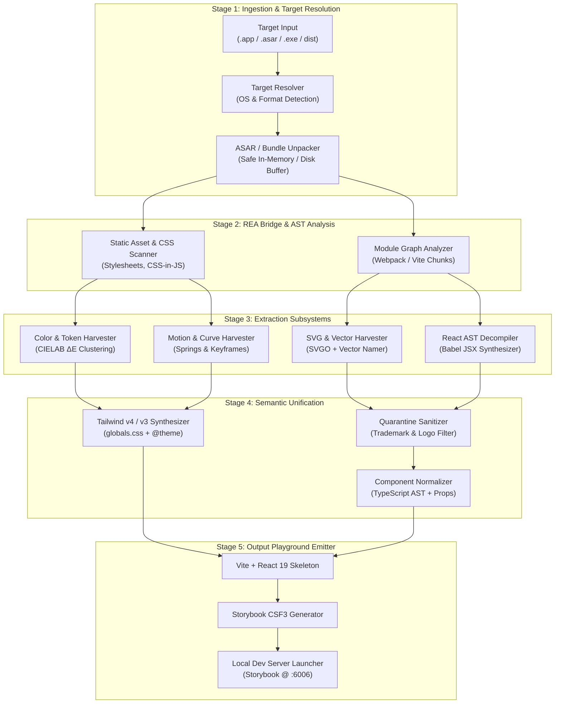
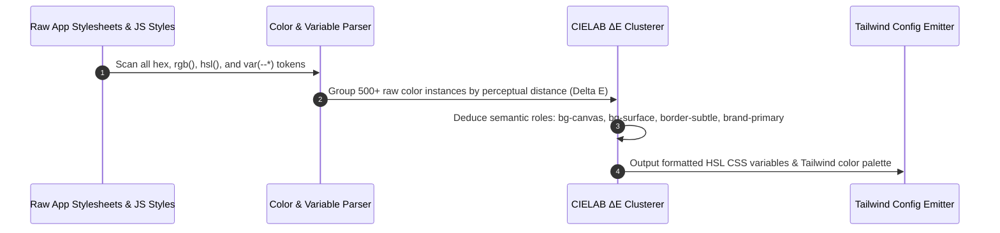
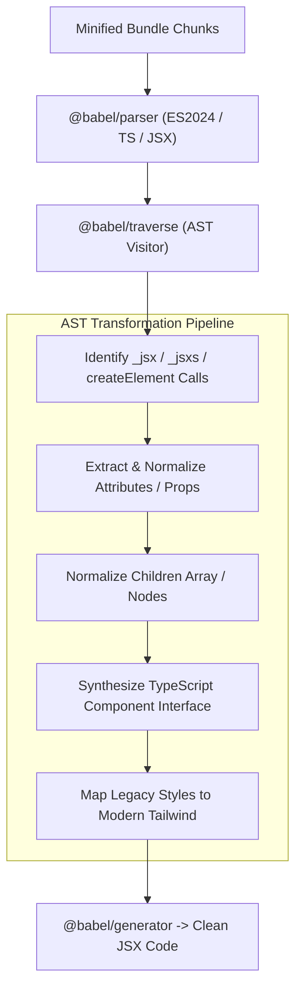
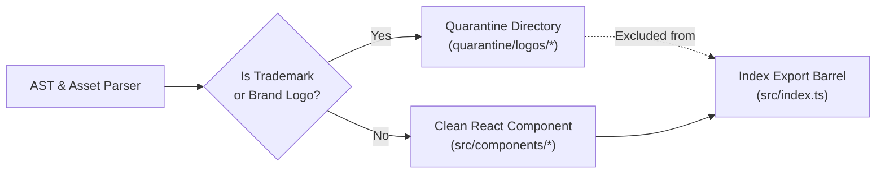

# Architecture Specification

# `rea-steal-ui` — System Architecture & Technical Design

This document details the internal architecture, mathematical models, AST transformation pipelines, and module boundaries of `rea-steal-ui`.

---

## 1. High-Level Architecture Overview

`rea-steal-ui` operates as a multi-stage compilation pipeline that converts minified desktop application binaries and web bundles into clean, typed, idiomatic React 19 + Tailwind CSS design systems.



---

## 2. Pipeline Subsystems in Detail

### 2.1 Stage 1: Target Ingestion & Bundle Parsing (`src/core/asar.ts` & `src/core/target.ts`)

The ingestion layer normalizes different application formats across macOS, Windows, and Linux into a uniform file system representation:

1. **Target Detection:**
   - **macOS:** Inspects `Contents/Resources/app.asar` or `Contents/Resources/app/`.
   - **Windows:** Inspects `resources/app.asar` or root executable folder.
   - **Web Bundle:** Identifies Vite/Webpack manifest files (`manifest.json`, `index.html`, `assets/*.js`).
2. **Safe ASAR Archive Extraction:**
   - Uses a stream-based ASAR archive unpacker with strict path validation.
   - Prevents directory traversal attacks ("Zip Slip") by ensuring all destination file paths resolve within the designated temporary scratch directory (`os.tmpdir()/rea-steal-ui-*`).
3. **Bundle Chunk Discovery:**
   - Discovers entry points, vendor bundles, and asynchronous chunks using AST pattern matching on Webpack runtime calls (`webpackJsonp`, `self.__LOADABLE_LOADED_CHUNKS__`) and ES dynamic `import()` tables.

---

### 2.2 Stage 2: REA Core Bridge (`src/core/rea-bridge.ts`)

The REA (Reverse Engineer Anything) bridge provides deep static inspection hooks:
- Traverses minified JavaScript files without executing untrusted code.
- Builds an indexed dependency graph of all modules, linking minified variable imports to their source chunk definitions.
- Identifies whether the target uses standard React, Preact, Emotion, Styled-Components, Vanilla Extract, or Tailwind CSS.

---

### 2.3 Stage 3: Color & Design Token Harvester (`src/extractors/tokens.ts`)

Desktop applications declare hundreds of ad-hoc color values that originate from a structured design system. The token harvester reconstructs this semantic system using perceptual color mathematics.



#### The Mathematical Model: Perceptual Color Clustering ($\Delta E$)
Human eyes do not perceive color differences linearly in RGB space. Two colors with a small Euclidean distance in RGB can appear distinctly different, while two colors with large RGB distances may look identical.

`rea-steal-ui` converts all discovered colors to the **CIE $L^*a^*b^*$** color space and calculates perceptual distance using the **CIE 1976 / CIELAB $\Delta E^*_{ab}$** formula:

$$\Delta E^*_{ab} = \sqrt{(L^*_2 - L^*_1)^2 + (a^*_2 - a^*_1)^2 + (b^*_2 - b^*_1)^2}$$

- **Perceptual Thresholds:**
  - $\Delta E \le 1.0$: Imperceptible to the human eye $\rightarrow$ Merged immediately.
  - $1.0 < \Delta E \le 2.5$: Perceptible through close observation $\rightarrow$ Clustered into single semantic shade.
  - $\Delta E > 2.5$: Noticeable difference $\rightarrow$ Treated as distinct design token.

#### Semantic Role Assignment Heuristic
Colors are automatically assigned to semantic roles based on lightness ($L^*$), chroma ($C^*$), and DOM usage frequency:

| Semantic Role | Selection Criteria | Example Clustered Output |
| :--- | :--- | :--- |
| `bg-canvas` | Lowest $L^*$ in dark mode ($L^* < 12$), high frequency in root container elements | `hsl(220, 15%, 7%)` |
| `bg-surface` | Slightly elevated lightness ($12 \le L^* \le 18$), card & panel containers | `hsl(220, 14%, 11%)` |
| `bg-elevated` | Modal and popover background ($18 \le L^* \le 25$) | `hsl(220, 13%, 16%)` |
| `border-subtle` | Low contrast against surface ($\Delta E \approx 3.0$), common in divider elements | `hsl(220, 10%, 20%)` |
| `text-primary` | Highest lightness in dark mode ($L^* \ge 90$) | `hsl(0, 0%, 98%)` |
| `text-muted` | Medium lightness ($50 \le L^* \le 70$), secondary labels | `hsl(220, 8%, 60%)` |
| `brand-primary` | Highest chroma ($C^*$) with consistent interactive button usage | `hsl(245, 82%, 67%)` |

---

### 2.4 Stage 4: Vector Asset & SVG Harvester (`src/extractors/icons.ts`)

Modern desktop applications embed icons as inline SVGs in React components rather than separate `.svg` files:

1. **AST Detection:**
   The visitor traverses the Babel AST searching for JSX elements or React createElement invocations with the tag name `"svg"`.
2. **SVGO Normalization:**
   - Strips hardcoded dimensions (`width`, `height`).
   - Standardizes `viewBox` coordinates to `0 0 24 24` or `0 0 16 16`.
   - Replaces hardcoded `fill` and `stroke` attributes with `currentColor`.
   - Ensures `strokeWidth="2"` and `strokeLinecap="round"` / `strokeLinejoin="round"` where appropriate.
3. **Geometric Shape Hashing & Auto-Naming:**
   Icons frequently lose their original names during minification (e.g. `const a = () => (0, r.jsx)("svg", ...)`).
   `rea-steal-ui` names icons using:
   - **Priority 1 (Semantic Attributes):** `aria-label`, `data-icon`, `title`, or parent component name.
   - **Priority 2 (Geometric Hash Matching):** Computes normalized SVG path curvature and coordinate vectors, matching them against an offline dictionary of Lucide and Feather icons (e.g., detecting standard magnifying glass paths as `SearchIcon.tsx`).

---

### 2.5 Stage 5: React Component AST Decompiler (`src/extractors/ast-decompiler.ts`)

Minified React bundles replace clean JSX syntax with compiled function calls:

```javascript
// Compiled Minified Call in target app bundle
(0, r.jsx)("button", {
  className: "px-4 py-2 bg-indigo-600 text-white rounded-md hover:bg-indigo-500",
  onClick: handleClick,
  children: (0, r.jsx)("span", { children: "Submit" })
})
```

The Babel AST decompiler reverses this transformation:



#### Signature Component Pattern Isolators
The decompiler contains heuristic detectors for high-value productivity application components:
- **Command Palette (`Cmd+K`):** Detects search input, keyboard navigation hooks (`ArrowUp`, `ArrowDown`, `Enter`), item group filters, and shortcut badges.
- **Modal / Dialog:** Detects fixed backdrop overlays, `createPortal` calls, escape key handlers, and modal surface containers.
- **Button:** Detects click handlers, disabled states, icon slots, and variant switches (`primary`, `secondary`, `ghost`).
- **Shortcut Key Badge:** Detects keyboard modifier symbols (`⌘`, `Ctrl`, `⇧`, `⌥`) with border and surface styling.

---

### 2.6 Stage 6: Project & Storybook Scaffolding (`src/generators/`)

Once components, icons, and tokens are extracted and unified:
1. **Template Instantiation (`src/generators/project.ts`):**
   - Scaffolds a lightweight, modern Vite + React 19 + TypeScript template.
   - Emits `package.json` with scripts: `dev`, `build`, `storybook`.
2. **Tailwind Synthesizer (`src/generators/tailwind.ts`):**
   - Emits `src/styles/globals.css` containing light and dark mode CSS variables.
   - Emits `tailwind.config.ts` (or `@theme` directive for Tailwind v4) mapping extracted semantic tokens.
3. **Storybook Story Synthesizer (`src/generators/storybook.ts`):**
   - Emits Component Story Format (CSF3) `.stories.tsx` files for each component.
   - Automatically populates mock args (e.g. sample items for `CommandMenu`, default text for `Button`).

---

## 3. Data Contracts & TypeScript Interfaces

The system is governed by strict TypeScript interfaces across all pipeline stages:

```typescript
// Core Token Contract
export interface DesignTokens {
  colors: {
    background: {
      canvas: string;
      surface: string;
      elevated: string;
      overlay: string;
    };
    foreground: {
      primary: string;
      secondary: string;
      muted: string;
      inverse: string;
    };
    border: {
      subtle: string;
      strong: string;
    };
    accent: {
      primary: string;
      hover: string;
      focus: string;
    };
  };
  typography: {
    fontFamilies: Record<string, string[]>;
    fontSizes: Record<string, { fontSize: string; lineHeight: string }>;
  };
  radii: Record<string, string>;
  shadows: Record<string, string>;
}

// Harvested SVG Icon Contract
export interface ExtractedIcon {
  name: string;             // e.g. "SearchIcon"
  viewBox: string;          // e.g. "0 0 24 24"
  paths: Array<{
    d: string;
    fillRule?: string;
    clipRule?: string;
  }>;
  originalName?: string;
  sourceFile: string;
}

// Decompiled Component Contract
export interface DecompiledComponent {
  name: string;             // e.g. "CommandPalette"
  propsInterface: string;   // TypeScript interface code string
  componentCode: string;    // Formatted React component string
  dependencies: string[];   // Icon imports, utility imports
  storyCode: string;        // CSF3 Storybook story code
}

// Complete Extraction Manifest
export interface ExtractionManifest {
  targetName: string;
  targetVersion: string;
  timestamp: string;
  tokens: DesignTokens;
  icons: ExtractedIcon[];
  components: DecompiledComponent[];
  quarantinedAssets: string[];
}
```

---

## 4. Legal & Clean-Room Architecture

To maintain ethical and legal compliance, `rea-steal-ui` implements an automated clean-room quarantine filter:



1. **Logo Identification:** Matches image assets, SVGs, and text against known proprietary brand marks (e.g., proprietary corporate logos, brand icons).
2. **Quarantine Isolation:** Detected brand assets are routed to a distinct `quarantine/` directory and explicitly commented out of the main export barrel.
3. **AST Synthesis Purity:** Emitted components are synthesized from functional layout trees, ensuring zero copyright infringement of proprietary source files.

---

## 5. Directory Layout of the Engine

```text
rea-steal-ui/
├── bin/
│   └── cli.ts                     # CLI executable entry point
├── src/
│   ├── core/
│   │   ├── asar.ts                # ASAR extraction & safe path resolver
│   │   ├── target.ts              # Target OS & bundle detector
│   │   └── rea-bridge.ts          # REA module graph bridge
│   ├── extractors/
│   │   ├── tokens.ts              # CIELAB Delta-E color & token harvester
│   │   ├── icons.ts               # SVGO cleaner & vector hash namer
│   │   ├── ast-decompiler.ts      # Babel React AST decompiler
│   │   ├── motion.ts              # Transition & spring curve extractor
│   │   └── quarantine.ts          # Trademark & logo isolation filter
│   ├── generators/
│   │   ├── project.ts             # Vite project structure scaffolder
│   │   ├── tailwind.ts            # Tailwind v4 / v3 theme emitter
│   │   ├── storybook.ts           # CSF3 storybook generator
│   │   └── component-scaffold.ts  # Component file & barrel emitter
│   ├── types/
│   │   └── index.ts               # Unified data contract interfaces
│   └── index.ts                   # Programmatic Node.js API
├── templates/
│   └── vite-react-tailwind/       # Base project template
├── test/
│   ├── fixtures/                  # Synthetic minified bundles
│   ├── tokens.test.ts             # Delta-E clustering tests
│   ├── icons.test.ts              # SVG normalizer tests
│   └── decompiler.test.ts         # AST transformation tests
├── package.json
├── tsconfig.json
└── vitest.config.ts
```

