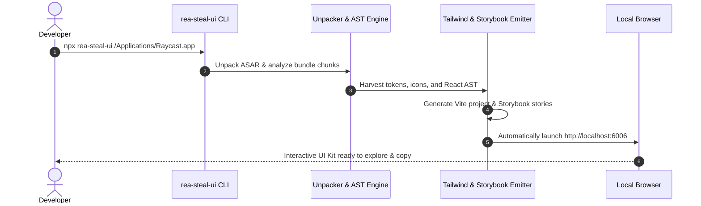

# Product Requirements Document (PRD)

# `rea-steal-ui` — Automated Design System & Component Extractor

| Document Metadata | Details |
| :--- | :--- |
| **Product Name** | `rea-steal-ui` |
| **Document Version** | 1.0.0 |
| **Status** | Approved / Active Development |
| **Target Release** | v1.0.0-beta.1 (Q4 2026) |
| **Lead Architect** | REA Core Team |
| **Product Category** | Developer Tools / Reverse Engineering / UI & Design Systems |

---

## 1. Executive Summary & Product Vision

### 1.1 Vision
Modern frontend development suffers from a massive aesthetic divide. Leading applications like **Linear, Raycast, Notion, Cursor, and Superhuman** invest millions of dollars into custom design tokens, micro-interactions, dark-mode palettes, and command palettes. Meanwhile, the vast majority of software teams, indie hackers, and open-source developers struggle to manually reproduce these aesthetics.

**`rea-steal-ui`** is an open-source CLI and developer tool that extracts complete design systems, color tokens, icons, and clean React + Tailwind components from any packaged desktop app or web bundle in **60 seconds or less**.

### 1.2 The North Star Metric
> **Time to Interactive Storybook (< 60 seconds):** A developer pointing the tool at a desktop binary must be browsing a pixel-perfect, interactive Storybook showcase of the extracted components within one minute.

---

## 2. Problem Statement & User Pain Points

### 2.1 The Current Manual Workflow
When a frontend engineer or designer wants to study or adopt the aesthetic of a benchmark desktop app:
1. **Minified Asset Inspecting:** They must unpack ASAR archives, search through obfuscated Webpack bundles, and decrypt mangled class names.
2. **Guesswork in Tokenizing:** Colors, gradients, and opacities are hand-picked via screen color pickers, losing the mathematical relationships of semantic design tokens (canvas vs. surface vs. elevated).
3. **SVG Harvesting Friction:** Icons are manually copied one by one from DOM elements, leaving hardcoded fill colors and incompatible viewBox dimensions.
4. **Component Reconstruction Overhead:** Decompiling compiled React `_jsx()` calls into idiomatic, typed TypeScript components with Tailwind classes takes hours per component.

### 2.2 The Solution
`rea-steal-ui` automates the entire ingestion, extraction, perceptual clustering, AST transformation, and code generation pipeline into a single zero-dependency CLI execution.

---

## 3. Target Audiences & Personas

### Persona 1: The Indie Hacker / Solo Developer
- **Profile:** Alex, full-stack developer building a SaaS productivity tool.
- **Goal:** Wants a slick, Linear-grade dark-mode UI with a Command Palette (`Cmd+K`) without spending 3 months designing it.
- **Key Pain Point:** Limited design budget; unable to craft high-fidelity CSS and micro-interactions from scratch.
- **Workflow:** Runs `npx rea-steal-ui /Applications/Linear.app --components command-menu,button` and immediately imports the scaffolded components.

### Persona 2: The Design Systems Engineer
- **Profile:** Priya, Staff Design Technologist at a growth-stage company.
- **Goal:** Wants to audit, benchmark, and harmonize design tokens across competitive applications.
- **Key Pain Point:** Difficult to extract systematic color ramps, font scales, and spacing constants from compiled web/desktop builds.
- **Workflow:** Runs `npx rea-steal-ui ./target.asar --tokens-only` to generate a standardized `tailwind.config.ts` and CSS variables manifest.

### Persona 3: The Enterprise Migration Engineer
- **Profile:** David, Senior Frontend Engineer migrating a legacy Electron app to a modern React 19 + Tailwind web platform.
- **Goal:** Wants to extract existing legacy components and modernize them into clean React JSX without manual rewrites.
- **Key Pain Point:** Legacy source code is fragmented or lost across multiple repositories.

---

## 4. User Journeys & Core Workflows

### Journey A: Full-Auto Extraction & Storybook Launch


### Journey B: Targeted Component Extraction
1. Developer runs `npx rea-steal-ui ./app.asar --components command-menu,modal --out ./my-components`.
2. CLI runs targeted AST filtering, skipping unrelated bundles.
3. CLI writes only the requested components, their accompanying icons, and their required CSS tokens.

### Journey C: Headless Token Extraction
1. Developer runs `npx rea-steal-ui ./dist --tokens-only --out ./theme`.
2. CLI extracts colors, typography, and spacing, emitting `globals.css` and `tailwind.config.ts` for direct drop-in to Next.js or Vite projects.

---

## 5. Functional Requirements (FR)

### FR-1: Target Ingestion & Bundle Parsing
- **FR-1.1:** CLI must automatically detect target format:
  - macOS `.app` bundles (locating `Contents/Resources/app.asar` or `Resources/app`).
  - Windows `.exe` directories / unpacked Electron apps.
  - Raw `.asar` archives.
  - Production web bundles (Webpack, Vite, Rollup dist directories).
- **FR-1.2:** CLI must safely unpack ASAR archives in memory or temporary directories without vulnerability to directory traversal (Zip slip).

### FR-2: Perceptual Color & Design Token Harvesting
- **FR-2.1:** Extractor must scan all CSS, CSS-in-JS tables, and inline styles for color declarations (`#hex`, `rgb()`, `hsl()`, `oklch()`).
- **FR-2.2:** Harvester must cluster colors using **CIELAB $\Delta E$ (Delta-E)** perceptual distance (threshold: $\Delta E \le 2.5$) to prevent redundant duplicate tokens.
- **FR-2.3:** System must assign semantic roles automatically:
  - `background`: Canvas, Surface, Elevated, Overlay
  - `foreground`: Primary, Secondary, Muted, Inverse
  - `border`: Subtle, Strong, Interactive
  - `accent`: Brand primary, Hover, Focus rings
- **FR-2.4:** Extractor must deduce typography scales (font sizes, weights, line heights) and spacing scales (4px / 8px grid alignment).

### FR-3: Vector Asset & SVG Harvesting
- **FR-3.1:** Engine must locate inline SVG elements and React vector path components (`<svg>`, `<path d="...">`) in the AST.
- **FR-3.2:** Normalizer must sanitize paths using `svgo`, strip hardcoded fills/strokes, and insert `currentColor`.
- **FR-3.3:** Icon normalizer must standardize viewBox coordinates to `0 0 24 24` or `0 0 16 16`.
- **FR-3.4:** Auto-naming engine must derive component names from SVG metadata, aria-labels, or geometric hash matching against standard icon sets (Lucide / Feather).

### FR-4: Babel AST React Decompiler
- **FR-4.1:** Decompiler must parse minified JavaScript AST using `@babel/parser`.
- **FR-4.2:** Must transform minified `(0, r.jsx)("button", ...)` and `React.createElement(...)` calls into idiomatic JSX.
- **FR-4.3:** Must extract component props and synthesize clean TypeScript interfaces (e.g. `ButtonProps extends React.ButtonHTMLAttributes<HTMLButtonElement>`).
- **FR-4.4:** Must isolate signature UI patterns:
  - Command Palette (`Cmd+K` searchable menu)
  - Dialog / Modal with backdrop blur
  - Dropdown & Context Menus
  - Action Buttons & Icon Buttons
  - Status Badges & Pills

### FR-5: CSS & Tailwind Utility Synthesis
- **FR-5.1:** Engine must convert minified class names or CSS-in-JS style objects into modern Tailwind CSS classes.
- **FR-5.2:** Must support both **Tailwind CSS v4** (CSS theme variables `@theme`) and **Tailwind CSS v3** (`tailwind.config.ts`).
- **FR-5.3:** Must generate `globals.css` defining all extracted HSL variables for dark and light modes.

### FR-6: Project Scaffolding & Storybook Integration
- **FR-6.1:** Scaffolder must output a standalone project with `package.json`, `tsconfig.json`, `vite.config.ts`.
- **FR-6.2:** Scaffolder must generate Component Story Format (CSF3) stories (`.stories.tsx`) for each extracted component.
- **FR-6.3:** Project must execute with `pnpm install && pnpm storybook` with zero configuration or build errors.

### FR-7: Interactive Terminal Experience
- **FR-7.1:** CLI must use `@clack/prompts` and `picocolors` to display clean progress spinners, step summaries, and success output.
- **FR-7.2:** CLI must display an extraction summary table showing token count, icon count, and decompiled component list.

### FR-8: Legal Quarantine & Asset Sanitization
- **FR-8.1:** Extractor must scan for proprietary trademarks, corporate brand names, and logo SVGs.
- **FR-8.2:** Any detected proprietary logo must be automatically routed to `quarantine/logos/` and excluded from the main export barrel.
- **FR-8.3:** Generated source code must be synthesized from structural AST observations, ensuring clean-room status.

---

## 6. Non-Functional Requirements (NFR)

| Area | Requirement | Target Metric |
| :--- | :--- | :--- |
| **Performance** | Total extraction and generation time for 100MB Electron bundle | $\le 60\text{ seconds}$ |
| **Code Quality** | Emitted TypeScript code strictness | Zero TypeScript errors (`tsc --noEmit` exits 0) |
| **Reliability** | Successful Storybook launch rate | $\ge 98\%$ of extracted kits build on first try |
| **Portability** | OS Support | macOS (Apple Silicon & Intel), Windows 11/10, Linux x64 |
| **Bundle Size** | CLI install footprint | Zero heavy binary dependencies (pure Node.js / WebAssembly) |
| **Memory** | Max RAM usage during bundle parsing | $\le 1.5\text{ GB}$ peak memory |

---

## 7. Success Metrics & Key Performance Indicators (KPIs)

1. **Adoption & Virality:**
   - 10,000+ GitHub Stars within 90 days of public release.
   - 50,000+ weekly `npx` executions.
2. **Extraction Fidelity:**
   - Greater than 90% visual parity score on benchmark applications (Linear, Raycast, Notion) measured via visual regression snapshots.
3. **Developer Delight:**
   - Median time from command execution to viewing Storybook under 45 seconds.
   - Less than 2% bug report rate on emitted TypeScript syntax.

---

## 8. Competitive Landscape & Differentiation

| Feature / Capability | `rea-steal-ui` | Chrome DevTools "Copy Element" | Generic JS Decompilers | Manual Replication |
| :--- | :---: | :---: | :---: | :---: |
| **Single-Command Workflow** | ✅ **Yes (60s)** | ❌ No | ❌ No | ❌ No (Weeks) |
| **ASAR / Desktop App Ingestion** | ✅ **Native** | ❌ No | ❌ Partial | ❌ Manual |
| **CIELAB Delta-E Token Clustering** | ✅ **Yes** | ❌ No | ❌ No | ❌ Guesswork |
| **Auto-Naming SVG Icons** | ✅ **Yes (Vector Hash)** | ❌ No | ❌ No | ❌ Manual |
| **Tailwind v4 / v3 Synthesis** | ✅ **Automated** | ❌ Raw CSS only | ❌ No | ❌ Manual |
| **Interactive Storybook Emitter** | ✅ **Zero-Config** | ❌ No | ❌ No | ❌ Manual setup |
| **Clean-Room Trademark Quarantine** | ✅ **Built-in** | ❌ No | ❌ No | ⚠️ High risk |

---

## 9. Product Roadmap

```text
Q4 2026: Phase 1 — MVP Core
├── Electron ASAR Unpacker & REA Module Graph Bridge
├── CIELAB Delta-E Color Harvester & Tailwind Theme Emitter
├── SVGO Icon Normalizer & Lucide Shape Classifier
└── Vite + React 19 Project Scaffolder

Q1 2027: Phase 2 — Component Decompilation & Polish
├── Babel AST _jsx to clean JSX Transformer
├── High-fidelity Command Palette (Cmd+K) & Modal Reconstructor
├── Storybook CSF3 Story Synthesizer
└── Terminal UX with @clack/prompts & Interactive Preview Mode

Q2 2027: Phase 3 — Ecosystem & Expansion
├── Headless Web App Extractor (URL Ingestion via Headless Chromium)
├── Figma Tokens (JSON) & Style Dictionary Exporters
├── Multi-Framework Emitters (Vue 3, Svelte 5)
└── Enterprise Clean-Room Compliance Audit Reports
```

