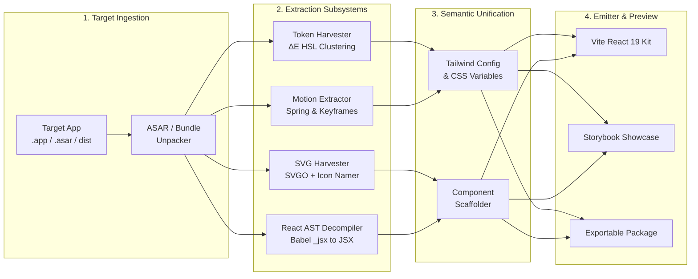

# rea-steal-ui

<div align="center">

```
  ██████╗ ███████╗ █████╗      ███████╗████████╗███████╗ █████╗ ██╗         ██╗   ██╗██╗
  ██╔══██╗██╔════╝██╔══██╗     ██╔════╝╚══██╔══╝██╔════╝██╔══██╗██║         ██║   ██║██║
  ██████╔╝█████╗  ███████║     ███████╗   ██║   █████╗  ███████║██║         ██║   ██║██║
  ██╔══██╗██╔══╝  ██╔══██║     ╚════██║   ██║   ██╔══╝  ██╔══██║██║         ██║   ██║██║
  ██║  ██║███████╗██║  ██║     ███████║   ██║   ███████╗██║  ██║███████╗    ╚██████╔╝██║
  ╚═╝  ╚═╝╚══════╝╚═╝  ╚═╝     ╚══════╝   ╚═╝   ╚══════╝╚═╝  ╚═╝╚══════╝     ╚═════╝ ╚═╝
```

### Extract complete design systems, color tokens, icons, and clean React + Tailwind components from any packaged desktop app or web bundle in 60 seconds.

[](https://www.npmjs.com/package/rea-steal-ui)
[](LICENSE)
[](https://www.typescriptlang.org/)
[](https://react.dev/)
[](https://tailwindcss.com/)
[](CONTRIBUTING.md)

[Quickstart](#-quickstart) • [Features](#-features) • [How It Works](#-how-it-works) • [CLI Reference](#-cli-reference) • [Architecture](#-architecture) • [Documentation](#-documentation)

---

</div>

## 💡 The Vision

Frontend engineers, UI/UX designers, and indie hackers spend countless hours admiring and attempting to manually replicate the world-class aesthetics of modern desktop applications like **Linear, Raycast, Notion, Cursor, and Superhuman**.

Rebuilding them by hand is painful:
- 🔍 Inspecting minified DOM elements and obfuscated bundle chunks.
- 🎨 Guessing color palettes, opacity levels, and border-radii by eye.
- 📐 Copying SVG paths manually from developer console dumps.
- ⚡ Struggling to reconstruct signature micro-interactions, spring animations, and command palettes.

**`rea-steal-ui`** turns this entire workflow into a **single 60-second command**:

```bash
npx rea-steal-ui /Applications/Linear.app --out ./linear-ui-kit
```

---

## ⚡ The 30-Second Terminal Walkthrough

```text
┌  rea-steal-ui v1.0.0 — Design System Extractor
│
◇  Target identified: Raycast for macOS (Electron 30.1.2)
◇  Unpacking application ASAR... [Done in 1.1s]
◇  Scanning 24 JavaScript bundles & AST nodes... [Done in 2.3s]
│
├  🎨 Extracted 42 color tokens (Dark Mode default, ΔE clustered)
├  ⚡ Harvested 189 SVG icons (normalized viewBox, currentColor)
├  🧩 Reconstructed 8 core components:
│  ● Button
│  ● CommandPalette (Cmd+K)
│  ● DropdownMenu
│  ● Modal
│  ● ShortcutKeyBadge
│
◇  Generating Vite + React 19 + Tailwind CSS playground...
◇  Synthesizing Storybook showcase...
│
└  🎉 Success! UI Kit generated at ./raycast-ui-kit
   Starting local Storybook preview at http://localhost:6006...
```

---

## ✨ Features

- **🎨 Perceptual Color & Token Harvester:**
  - Scans minified stylesheets, CSS variables, and CSS-in-JS tables.
  - Clusters raw hex/rgb/hsl values using **CIELAB $\Delta E$ (Delta-E)** perceptual color distance into semantic tokens (`bg-canvas`, `bg-surface`, `border-subtle`, `brand-primary`).
  - Automatically extracts typography scales, line heights, border-radii, and multi-layered elevation box shadows.

- **⚡ Vector Asset & SVG Harvester:**
  - Extracts inline SVGs and vector paths directly from JavaScript AST.
  - Strips hardcoded colors, replacing them with `currentColor`.
  - Normalizes viewBox coordinates (`0 0 24 24` or `0 0 16 16`).
  - Auto-names icons using geometric signature matching against standard icon libraries (Lucide / Feather).

- **🧩 Babel AST React Decompiler:**
  - Decompiles minified `_jsx()` and `React.createElement()` calls back into clean, readable, idiomatic JSX.
  - Maps legacy CSS classes or atomic style objects to modern **Tailwind CSS v4** utility classes.
  - Detects signature UI patterns: **Command Palette (`Cmd+K`)**, Modals, Dropdowns, Badges, and Tabs.

- **🚀 Instant Storybook & Vite Playground:**
  - Automatically scaffolds a zero-config Vite + React 19 + Tailwind project.
  - Generates Storybook Component Story Format (CSF3) `.stories.tsx` files for every extracted component.
  - Launches an interactive local preview with one command.

- **🛡️ Clean-Room & Quarantine Protection:**
  - Ensures full clean-room compliance: reconstructs functional UI code rather than duplicating proprietary application logic.
  - Automatically quarantines corporate trademarks, logos, and branded assets into a separate `quarantine/` directory.

---

## 🚀 Quickstart

Run directly using `npx` (no prior global install required):

```bash
# Extract from a macOS .app bundle
npx rea-steal-ui /Applications/Linear.app

# Extract from an unpacked Electron ASAR file
npx rea-steal-ui ./resources/app.asar --out ./extracted-ui

# Extract from a production web build directory
npx rea-steal-ui ./dist --out ./web-ui-kit

# Preview extracted components directly in your browser without saving files
npx rea-steal-ui /Applications/Raycast.app --preview
```

---

## 🛠️ CLI Reference

```text
Usage: rea-steal-ui <target-path> [options]

Arguments:
  <target-path>               Path to .app bundle, .asar file, .exe directory, or web dist folder

Options:
  -o, --out <path>            Output directory for generated UI kit (default: ./<target-name>-ui-kit)
  -c, --components <list>     Comma-separated list of components to isolate (e.g., "button,command-menu,modal")
  --tokens-only               Extract only design tokens, CSS variables, and tailwind.config.ts
  --icons-only                Extract only SVG vector icons as React icon components
  --preview                   Launch local Storybook preview in memory without writing to disk
  --tailwind-version <v>      Target Tailwind version: "3" or "4" (default: "4")
  --typescript                Generate TypeScript components (default: true)
  --clean-room-strict         Quarantine any detected brand logos or proprietary trademarks (default: true)
  -v, --verbose               Enable verbose logging for AST debugging
  -h, --help                  Display CLI help
  -V, --version               Display CLI version
```

### Common Usage Examples

#### 1. Extract only the Design Tokens & Color Palette
```bash
npx rea-steal-ui /Applications/Notion.app --tokens-only --out ./notion-tokens
```

#### 2. Extract specific components
```bash
npx rea-steal-ui ./app.asar --components command-menu,button,badge
```

#### 3. Generate Tailwind v3 compatible output
```bash
npx rea-steal-ui /Applications/Linear.app --tailwind-version 3
```

---

## 🏗️ Architecture



For the complete technical breakdown of the AST decompiler, Delta-E color math, and module pipeline, see [ARCHITECTURE.md](ARCHITECTURE.md).

---

## 📁 Generated Project Structure

Running `rea-steal-ui` generates a standalone, zero-dependency modern React library ready to import into your projects:

```text
linear-ui-kit/
├── .storybook/                  # Storybook configuration
│   ├── main.ts
│   └── preview.ts
├── src/
│   ├── components/              # Extracted Clean React Components
│   │   ├── Button/
│   │   │   ├── Button.tsx
│   │   │   └── Button.stories.tsx
│   │   ├── CommandMenu/
│   │   │   ├── CommandMenu.tsx
│   │   │   └── CommandMenu.stories.tsx
│   │   ├── Modal/
│   │   │   ├── Modal.tsx
│   │   │   └── Modal.stories.tsx
│   │   └── Dropdown/
│   │       ├── Dropdown.tsx
│   │       └── Dropdown.stories.tsx
│   ├── icons/                   # All extracted SVG Icons as React components
│   │   ├── SearchIcon.tsx
│   │   ├── SettingsIcon.tsx
│   │   └── index.ts
│   ├── styles/
│   │   ├── globals.css          # CSS Variables (Dark/Light tokens)
│   │   └── animations.css       # Spring & Bezier transitions
│   ├── index.ts                 # Main export barrel
│   └── tailwind.config.ts       # Extracted Tailwind theme configuration
├── package.json
├── tsconfig.json
└── vite.config.ts
```

---

## 📚 Documentation

Detailed documentation is available in the repository:

- 📋 [**PRD.md**](PRD.md) — Product Requirements Document, user personas, functional specifications, and success metrics.
- 🏛️ [**ARCHITECTURE.md**](ARCHITECTURE.md) — System architecture, AST transformation pipeline, Delta-E color math, and module design.
- 💻 [**DEVELOPMENT.md**](DEVELOPMENT.md) — Local developer setup, test suites, AST debugging workflows, and release lifecycle.
- 🤖 [**AGENT.md**](AGENT.md) — AI coding agent guide for Antigravity, Cursor, Copilot, and Claude Code assistants.
- 🤝 [**CONTRIBUTING.md**](CONTRIBUTING.md) — Contribution guidelines, PR process, and code style.
- 🔒 [**SECURITY.md**](SECURITY.md) — Security policy, static analysis guarantees, and clean-room quarantine protocols.
- 📜 [**CHANGELOG.md**](CHANGELOG.md) — Release history and migration notes.

---

## ⚖️ Legal & Clean-Room Compliance

`rea-steal-ui` is built with deep respect for intellectual property and open-source ethics:

1. **Functional Design & Tokens:** Under international copyright law, color values, layout spacing scales, typography metrics, and standard functional UI controls (buttons, dialogs, form elements) are functional ideas that are not copyrightable.
2. **Clean-Room Code Synthesis:** The engine does not copy proprietary source files. It reconstructs modern, clean-room React 19 + Tailwind code from structural AST observations.
3. **Trademark Quarantine:** Any proprietary company logos, trademarks, and brand assets detected during extraction are automatically isolated in `quarantine/logos/` and excluded from default component exports.

---

## 🤝 Community & Contributing

Contributions are warmly welcomed! Please read our [Contributing Guide](CONTRIBUTING.md) and [Code of Conduct](CODE_OF_CONDUCT.md) before submitting a Pull Request.

- ⭐ **Star this repository** if you find it helpful!
- 🐛 **Found a bug?** Open an [Issue](https://github.com/rea-steal-ui/rea-steal-ui/issues).
- 💡 **Have a feature request?** Start a [Discussion](https://github.com/rea-steal-ui/rea-steal-ui/discussions).

---

## 📄 License

Distributed under the **MIT License**. See [`LICENSE`](LICENSE) for more information.

