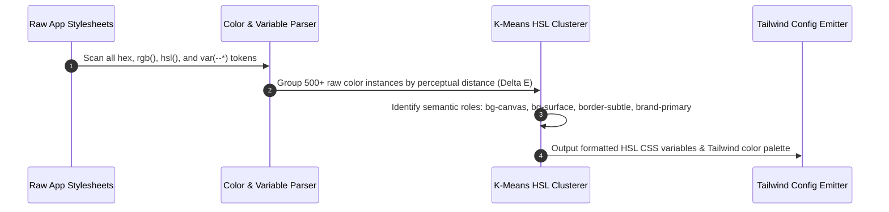
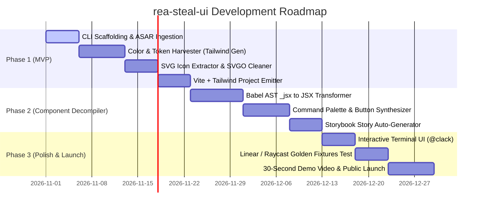

# `rea-steal-ui` — Project Specification & Architecture

> **Extract complete design systems, color tokens, icons, and clean React + Tailwind components from any packaged desktop app or web bundle in 60 seconds.**  
> *Powered by REA (Reverse Engineer Anything).*

---

## 1. Executive Summary & The Viral Hook

### 1.1 The Vision
Frontend engineers, UI/UX designers, and indie hackers spend countless hours admiring and attempting to manually replicate the world-class aesthetics of modern desktop applications like **Linear, Raycast, Notion, Cursor, and Superhuman**.

Rebuilding them by hand is tedious:
- Inspecting minified DOM elements one by one.
- Guessing color palettes, opacity levels, and border-radii.
- Copying SVG paths manually from inspector dumps.
- Struggling to re-create signature micro-interactions and command palettes.

**`rea-steal-ui`** turns this entire workflow into a **single 60-second command**:
```bash
npx rea-steal-ui /Applications/Linear.app --out ./linear-ui-kit
```

### 1.2 The "Holy Shit!" Viral Demo (30 Seconds on X/Twitter)
1. **0:00 - 0:05:** Terminal opens. The developer types `npx rea-steal-ui ./Raycast.app`.
2. **0:05 - 0:25:** The cyberpunk CLI dashboard runs:
   - 📦 Unpacking ASAR bundle...
   - 🎨 Extracting 48 design tokens & dark-mode HSL palette...
   - ⚡ Harvesting 164 inline SVG icons...
   - 🧩 Decompiling React AST for `CommandMenu`, `Button`, `Modal`...
   - 🚀 Synthesizing Tailwind config & Storybook preview...
3. **0:25 - 0:30:** Browser pops up automatically running a local **Storybook / Vite playground** displaying the pixel-perfect, interactive Raycast dark-mode UI kit ready for `npm install`.

---

## 2. System Architecture

```mermaid
flowchart TB
    subgraph Target["1. Input Application"]
        App["Target App<br/>(.app / .exe / .asar / web dist)"]
    end

    subgraph REA_Bridge["2. REA Core Engine"]
        REA_JS["rea analyze-javascript-application<br/>(Module graph, Webpack chunks, AST)"]
        REA_Assets["rea inspect-package-resources<br/>(CSS styles, assets, fonts)"]
    end

    subgraph Extractors["3. Extraction Subsystems"]
        TokenHarvester["Color & Design Token Harvester<br/>(HSL Clustering, Typography, Shadows)"]
        SVGHarvester["Icon & Vector Asset Harvester<br/>(SVG normalizer, AI icon namer)"]
        JSXDecompiler["React Component Decompiler<br/>(AST _jsx -> clean JSX, Tailwind generator)"]
        MotionExtractor["Animation & Cubic-Bezier Extractor<br/>(Keyframes, Spring Physics configs)"]
    end

    subgraph Normalizer["4. Semantic Unification"]
        TailwindSynthesizer["Tailwind Theme Generator<br/>(tailwind.config.ts + globals.css)"]
        ComponentScaffolder["Component Scaffolder<br/>(TypeScript + React 19 / Lucide icons)"]
    end

    subgraph Emitter["5. Output Playground"]
        ViteProject["Vite + React 19 + Tailwind Project"]
        Storybook["Interactive Storybook Showcase"]
        NpmPackage["Exportable Component Library"]
    end

    App --> REA_JS & REA_Assets

    REA_JS --> JSXDecompiler
    REA_Assets --> TokenHarvester & SVGHarvester & MotionExtractor

    TokenHarvester & MotionExtractor --> TailwindSynthesizer
    SVGHarvester & JSXDecompiler --> ComponentScaffolder

    TailwindSynthesizer --> ViteProject & Storybook & NpmPackage
    ComponentScaffolder --> ViteProject & Storybook & NpmPackage
```



---

## 3. Subsystem Deep Dive

### 3.1 Subsystem A: Target Ingestion & REA Extraction Adapter
* Uses REA's JavaScript application analyzer to parse the target's module graph.
* Locates compiled Webpack / Rollup / Vite chunks inside the application's ASAR or bundle directory.
* Parses minified CSS stylesheets, CSS-in-JS object tables (Emotion, Styled-Components, Vanilla Extract), and compiled Tailwind utility lists.

### 3.2 Subsystem B: Color & Design Token Harvester
Desktop applications don't declare colors randomly; they use strict design systems. The harvester reconstructs the semantic palette:



* **Color Clustering:** Merges nearly identical shades (e.g., `#0f1015` and `#0f1116`) into a single semantic token.
* **Semantic Role Deduction:** Automatically categorizes colors into:
  - `background`: Canvas, Surface, Elevated, Overlay
  - `foreground`: Primary, Secondary, Muted, Inverse
  - `border`: Subtle, Strong, Interactive
  - `accent`: Primary brand, Hover states, Focus rings
* **Typography & Spacing:** Extracts font-family declarations, font-size scales, line-heights, and spacing grid units (4px/8px bases).
* **Elevation & Shadows:** Captures complex multi-layered box-shadows and backdrop blur filters.

### 3.3 Subsystem C: Icon & Vector Asset Harvester
Modern desktop apps embed hundreds of icons as inline SVG elements or React components:
* **Detection:** Locates SVG path definitions within JSX AST (`<svg>`, `<path d="...">`).
* **Normalization:** 
  - Strips hardcoded colors and replaces them with `currentColor`.
  - Normalizes `viewBox` coordinates (e.g., standardized `0 0 24 24` or `0 0 16 16`).
* **Auto-Naming Engine:**
  - Extracts names from SVG `id`, `aria-label`, or component variable names.
  - Falls back to a local geometric signature matcher comparing path vectors against Lucide / Heroicons to automatically name icons (e.g., `SearchIcon.tsx`, `SettingsIcon.tsx`, `CloseIcon.tsx`).

### 3.4 Subsystem D: The React Component Decompiler
Minified React code compiles JSX into nested function calls:
```javascript
// Minified Compiled Code
(0, r.jsx)("button", { className: "btn-primary", onClick: e, children: (0, r.jsx)("span", { children: "Submit" }) })
```

`rea-steal-ui`'s AST transformer reconstructs this into clean, idiomatic JSX:
```tsx
// Decompiled & Formatted Component Output
export interface ButtonProps extends React.ButtonHTMLAttributes<HTMLButtonElement> {
  variant?: "primary" | "secondary";
}

export const Button: React.FC<ButtonProps> = ({ children, onClick, ...props }) => {
  return (
    <button 
      onClick={onClick}
      className="inline-flex items-center justify-center rounded-lg bg-brand-primary px-4 py-2 font-medium text-white shadow-sm transition hover:bg-brand-primary/90"
      {...props}
    >
      <span>{children}</span>
    </button>
  );
};
```

* **Tailwind Conversion:** Maps legacy CSS classes or CSS-in-JS style objects into modern Tailwind CSS utility classes.
* **Signature Component Isolation:** Specifically identifies and extracts high-demand UI patterns:
  - **Command Palette (`Cmd+K` menu):** Reconstructs search input, grouped lists, shortcut badges, and selected item states.
  - **Dropdown & Context Menus:** Extracts positioning logic, item separators, and keyboard navigation.
  - **Modals & Dialogs:** Extracts backdrop blurs, transition animations, and close triggers.
  - **Badges & Tags:** Reconstructs status indicators and pill tags.

---

## 4. Generated Project Structure

Running `rea-steal-ui` outputs a ready-to-use, zero-dependency modern React library:

```text
linear-ui-kit/
├── .storybook/                  # Storybook configuration
│   ├── main.ts
│   └── preview.ts
├── src/
│   ├── components/              # Extracted Clean React Components
│   │   ├── Button/
│   │   │   ├── Button.tsx
│   │   │   └── Button.stories.tsx
│   │   ├── CommandMenu/
│   │   │   ├── CommandMenu.tsx
│   │   │   └── CommandMenu.stories.tsx
│   │   ├── Modal/
│   │   │   ├── Modal.tsx
│   │   │   └── Modal.stories.tsx
│   │   └── Dropdown/
│   │       ├── Dropdown.tsx
│   │       └── Dropdown.stories.tsx
│   ├── icons/                   # All extracted SVG Icons as React components
│   │   ├── SearchIcon.tsx
│   │   ├── SettingsIcon.tsx
│   │   └── index.ts
│   ├── styles/
│   │   ├── globals.css          # CSS Variables (Dark/Light tokens)
│   │   └── animations.css       # Spring & Bezier transitions
│   ├── index.ts                 # Main export barrel
│   └── tailwind.config.ts       # Extracted Tailwind theme configuration
├── package.json
├── tsconfig.json
└── vite.config.ts
```

---

## 5. CLI Specification & User Experience

Built with `@clack/prompts` and `picocolors` for a sleek, modern terminal interface.

### 5.1 Commands

```bash
# 1. Full Auto Extraction & Launch Storybook
npx rea-steal-ui /Applications/Linear.app

# 2. Extract specific components only
npx rea-steal-ui ./app.asar --components command-menu,buttons --out ./my-kit

# 3. Export only the Tailwind theme & icons
npx rea-steal-ui ./Notion.app --tokens-only --icons-only

# 4. Preview extracted design system in browser without writing files
npx rea-steal-ui ./Raycast.app --preview
```

### 5.2 Interactive Terminal Flow
```text
┌  rea-steal-ui v1.0.0 — Design System Extractor
│
◇  Target identified: Raycast for macOS (Electron 30.1.2)
◇  Unpacking application ASAR... [Done in 1.2s]
◇  Scanning 24 JavaScript bundles... [Done in 2.4s]
│
├  🎨 Extracted 42 color tokens (Dark Mode default)
├  ⚡ Harvested 189 SVG icons
├  🧩 Reconstructed 8 core components:
│  ● Button
│  ● CommandPalette (Cmd+K)
│  ● DropdownMenu
│  ● Modal
│  ● ShortcutKeyBadge
│
◇  Generating Vite + Storybook playground...
│
└  🎉 Success! UI Kit generated at ./raycast-ui-kit
   Starting local Storybook preview at http://localhost:6006...
```

---

## 6. Development & Tech Stack

### 6.1 Toolchain & Dependencies

| Area | Technology | Purpose |
| :--- | :--- | :--- |
| **CLI & Runtime** | Node.js 22+, TypeScript 5.6 | Primary language and CLI execution. |
| **AST Transformation** | `@babel/parser`, `@babel/traverse`, `@babel/generator` | Parsing minified React AST and decompiling into JSX. |
| **CSS & Token Processing** | `postcss`, `colord`, `culori` | Color clustering, HSL normalization, Delta-E calculations. |
| **SVG Processing** | `svgo`, `cheerio` | Cleaning SVG paths and converting to React JSX elements. |
| **Project Templating** | `degit` or embedded Vite template | Generating zero-config Vite + Storybook skeleton. |
| **Testing** | `vitest` | Unit tests against synthetic minified React build fixtures. |

### 6.2 Codebase Directory Layout

```text
rea-steal-ui/
├── bin/
│   └── cli.ts                   # Executable entry point
├── src/
│   ├── core/
│   │   ├── asar.ts              # ASAR archive unpacker
│   │   └── rea-bridge.ts        # REA MCP/CLI communication layer
│   ├── extractors/
│   │   ├── tokens.ts            # Palette & spacing token analyzer
│   │   ├── icons.ts             # SVG parser & icon classifier
│   │   ├── ast-decompiler.ts    # React _jsx to clean JSX transformer
│   │   └── motion.ts            # Keyframe & animation curve extractor
│   ├── generators/
│   │   ├── tailwind.ts          # tailwind.config.ts generator
│   │   ├── storybook.ts         # Storybook story synthesizer
│   │   └── project.ts           # Vite project emitter
│   └── index.ts
├── templates/
│   └── vite-react-tailwind/     # Base skeleton template
├── test/
│   ├── fixtures/                # Sample minified React bundles
│   └── extractors.test.ts
├── package.json
└── README.md
```

---

## 7. Legal, Ethics & Clean-Room Compliance

To ensure `rea-steal-ui` is safe, ethical, and respected in the open-source community:

1. **Design Tokens & Geometry are Not Copyrightable:** 
   Under US and international copyright law, color palettes, hex codes, layout spacing scales, and standard functional UI controls (buttons, modals, input fields) are non-copyrightable functional ideas.
2. **Branding & Trademark Sanitization:**
   - Any proprietary company logos, trademarks, and brand marks detected during extraction are automatically placed into a quarantine directory (`quarantine/logos/`) and excluded from the default component barrel.
3. **Clean-Room Code Synthesis:**
   - The tool does not copy original source files verbatim. It synthesizes new, clean, idiomatic React 19 + Tailwind code from structural AST observations, ensuring clean-room status.

---

## 8. Launch & Virality Playbook

### 8.1 The "Launch Day" Asset Pack
* **Launch Video:** A 45-second high-energy screen recording showing `rea-steal-ui` extracting the **Linear dark-mode command palette** and running it in Storybook in real time.
* **Pre-Built Showcases:**
  - Launch with 3 ready-made GitHub demo repos:
    - `linear-ui-extracted`
    - `raycast-ui-extracted`
    - `notion-ui-extracted`
* **Distribution Channels:**
  - **X/Twitter:** Post tag: *"Stop rebuilding Linear's UI from scratch. I built an open-source tool that extracts design systems, icons, and React components from any desktop app in 60s."*
  - **Hacker News:** *Show HN: rea-steal-ui – Extract design systems and React components from desktop apps*
  - **Reddit:** Post in `r/reactjs`, `r/webdev`, `r/nextjs`, `r/SideProject`.

---

## 9. Implementation Roadmap



### Phase 1: MVP Core (Weeks 1–3)
- ASAR extraction + REA module graph integration.
- Color palette clustering and `tailwind.config.ts` generator.
- SVG path extraction into clean `Icon.tsx` components.
- Output clean Vite + Tailwind React boilerplate.

### Phase 2: Component Decompilation (Weeks 4–6)
- AST decompiler converting `React.createElement` / `_jsx` calls into formatted JSX.
- Automatic extraction of Buttons, Modals, and Command Palettes.
- Automatic generation of Storybook `.stories.tsx` files.

### Phase 3: Launch (Weeks 7–8)
- Polish CLI terminal experience with `@clack/prompts`.
- Publish npm package `rea-steal-ui`.
- Record demo video and execute the launch playbook.
